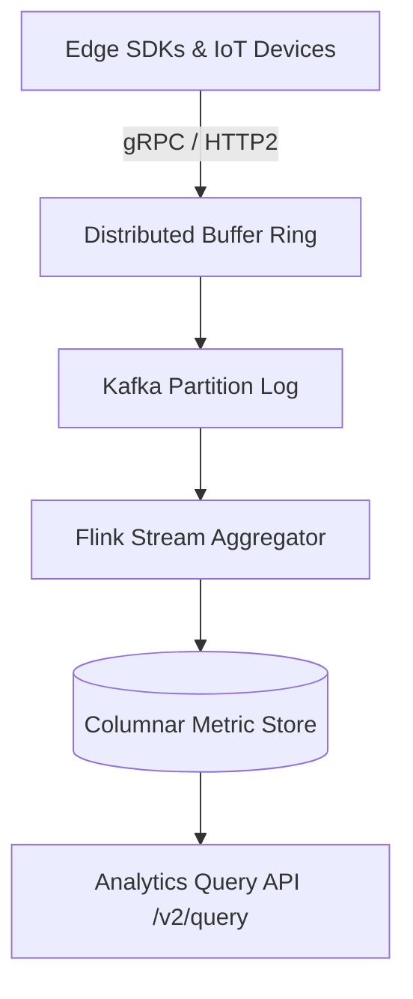

# Analytics & Metrics Ingestion API Reference

The **Analytics Ingestion Engine** supports high-throughput telemetry data capture, windowed aggregate queries, and real-time percentile computation.

---

## 1. Ingestion Architecture



Latency percentiles are computed via the nearest-rank method over sample size $N$:

$$
P = \left\lceil \frac{q}{100} \cdot N \right\rceil, \quad q \in \{50, 90, 95, 99\}
$$

Windowed exponential moving average (EMA) smoothing for throughput estimation:

$$
S_t = \alpha \cdot Y_t + (1 - \alpha) \cdot S_{t-1}, \quad \alpha = \frac{2}{k + 1}
$$

---

## 2. Ingesting Batch Telemetry Events

### Endpoint: `POST /v2/events/batch`

Accepts compressed NDJSON or JSON array batches up to 10,000 records per submission.

```python
import json
import requests

def push_event_batch(events: list[dict], api_key: str) -> dict:
    url = "https://analytics.contextglance.io/v2/events/batch"
    headers = {
        "Authorization": f"Bearer {api_key}",
        "Content-Type": "application/json",
        "X-Compression-Type": "none"
    }
    response = requests.post(url, json={"events": events}, headers=headers, timeout=5.0)
    response.raise_for_status()
    return response.json()
```

---

## 3. Query Parameter Specifications

| Parameter Name | Data Type | Mandatory | Default | Description |
| :--- | :--- | :--- | :--- | :--- |
| `time_start` | ISO-8601 String | Yes | None | Beginning of query window |
| `time_end` | ISO-8601 String | Yes | `now()` | End timestamp of query window |
| `metric_name` | String | Yes | None | Metric name (e.g., `cpu.load`, `http.latency`) |
| `step_interval` | Enum (`1m`, `5m`, `1h`) | No | `5m` | Aggregation bucket duration |
| `group_by` | List[String] | No | `[]` | Dimensions to partition aggregates |

---

## 4. Query Execution Example

```typescript
import { AnalyticsClient } from '@context-glance/analytics';

const client = new AnalyticsClient({ apiKey: 'ag_live_771891' });

export async function fetchP99Latency(serviceName: string): Promise<number[]> {
    const timeseries = await client.query({
        metric: 'http.request.duration_ms',
        aggregation: 'p99',
        filter: { service: serviceName },
        window: { start: 'now-24h', end: 'now' },
        interval: '15m'
    });

    return timeseries.dataPoints.map(dp => dp.value);
}
```

<details>
<summary><b>Rate Limiting & Concurrency Controls</b></summary>

Standard tier accounts allow up to 5,000 ingest events per second with bursts up to 10,000/sec. Rate limits return an `HTTP 429 Too Many Requests` containing an `X-RateLimit-Reset` Unix epoch timestamp.

Some Code Example:

```typescript
import { AnalyticsClient } from '@context-glance/analytics';

const client = new AnalyticsClient({ apiKey: 'ag_live_771891' });

export async function fetchP99Latency(serviceName: string): Promise<number[]> {
    const timeseries = await client.query({
        metric: 'http.request.duration_ms',
        aggregation: 'p99',
        filter: { service: serviceName },
        window: { start: 'now-24h', end: 'now' },
        interval: '15m'
    });

    return timeseries.dataPoints.map(dp => dp.value);
}
```

Some Math Example:

$$x = y + c$$

<details>
<summary><b>Rate Limiting & Concurrency Controls</b></summary>
<br>
Standard tier accounts allow up to 5,000 ingest events per second with bursts up to 10,000/sec. Rate limits return an `HTTP 429 Too Many Requests` containing an `X-RateLimit-Reset` Unix epoch timestamp.

Some Code Example:

```typescript
import { AnalyticsClient } from '@context-glance/analytics';

const client = new AnalyticsClient({ apiKey: 'ag_live_771891' });

export async function fetchP99Latency(serviceName: string): Promise<number[]> {
    const timeseries = await client.query({
        metric: 'http.request.duration_ms',
        aggregation: 'p99',
        filter: { service: serviceName },
        window: { start: 'now-24h', end: 'now' },
        interval: '15m'
    });

    return timeseries.dataPoints.map(dp => dp.value);
}
```

Some Math Example:

$$x = y + c$$


</details>


</details>
