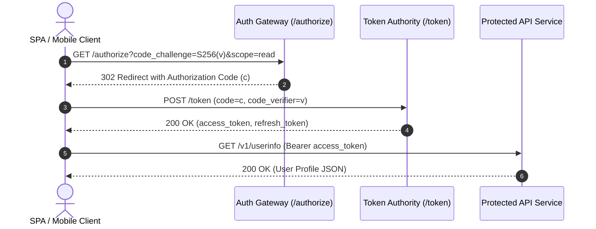

# Authentication & Identity REST API Reference

The **Auth & Identity Service** provides stateless JSON Web Token (JWT) issuing, OAuth 2.0 PKCE handshake workflows, and role-based access control (RBAC) validation across distributed services.

---

## 1. OAuth 2.0 PKCE Handshake Workflow

Clients initiate session authorization by generating a cryptographically secure random string known as the `code_verifier`, alongside a derived `code_challenge`:



The SHA-256 transformation for code challenge derivation follows:

$$
\text{Challenge}(v) = \text{Base64URL}\Big(\text{SHA-256}\big(v\big)\Big)
$$

Entropy requirement for code verifier:

$$
H(X) = -\sum_{i=1}^{n} P(x_i) \log_2 P(x_i) \ge 128 \text{ bits}
$$

---

## 2. Token Issuance Endpoints

### Endpoint: `POST /v1/auth/tokens`

Issues an asymmetric signed JWT token for authenticated credentials.

#### Request Headers & Body

```bash
curl -X POST https://api.contextglance.io/v1/auth/tokens \
  -H "Content-Type: application/json" \
  -d '{
    "client_id": "client_app_89f02b",
    "grant_type": "authorization_code",
    "code": "ac_982bfb1a45",
    "code_verifier": "dBjftJeZ4CVP-mB92K27uhbUJU1p1r_wW1gFWFOEjXk"
  }'
```

#### Response Payload

```typescript
interface TokenResponse {
    token_type: 'Bearer';
    access_token: string;
    expires_in: number;
    refresh_token: string;
    scope: string[];
    user: {
        id: string;
        email: string;
        roles: ('admin' | 'editor' | 'viewer')[];
    };
}
```

---

## 3. Scope Permissions Matrix

The following table outlines required scopes for security enforcement:

| Scope Identifier | Granted Capability | Target Service | Risk Level |
| :--- | :--- | :--- | :--- |
| `identity:read` | Read public user profile data | User Service | Low |
| `identity:write` | Modify user credentials & emails | User Service | High |
| `tokens:refresh` | Exchange active refresh tokens | Auth Authority | Medium |
| `admin:all` | Global administrative overrides | Control Plane | Critical |

---

## 4. Token Cryptography & Verification

Verification of an RS256 token requires public key extraction:

```typescript
import { createPublicKey, verify } from 'crypto';

export function verifyAccessToken(token: string, publicKeyPem: string): boolean {
    const [headerB64, payloadB64, signatureB64] = token.split('.');
    if (!headerB64 || !payloadB64 || !signatureB64) {
        throw new Error('Malformed JWT structure');
    }

    const data = Buffer.from(`${headerB64}.${payloadB64}`);
    const signature = Buffer.from(signatureB64, 'base64url');
    const pubKey = createPublicKey(publicKeyPem);

    return verify('RSA-SHA256', data, pubKey, signature);
}
```

<details>
<summary><b>Security Best Practice: Key Rotation & Clock Skew Tolerance</b></summary>
<br>
Auth services rotate signing keys every 30 days. Clients should cache JWKS endpoints for up to 1 hour and allow up to 60 seconds of clock skew tolerance ($t \pm 60\text{s}$) during signature timestamp inspection.
</details>
