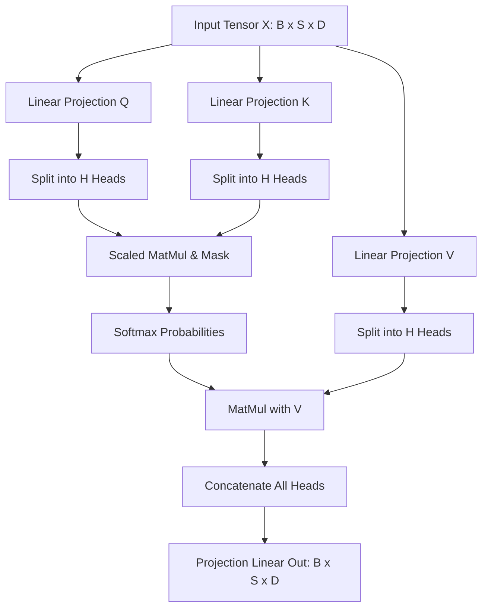

# Neural Network Layers & Tensor Operators Library

`@context-glance/nn-layers` is a high-performance deep learning computation library providing composable neural network layers, autograd tensor backward passes, and activation functions.

---

## 1. Activation Functions & Loss Formulations

### Scaled Dot-Product Attention

$$
\text{Attention}(Q, K, V) = \text{softmax}\left(\frac{Q K^T}{\sqrt{d_k}}\right) V
$$

Where queries $Q$, keys $K$, and values $V$ have sequence dimension $d_k$.

### Softmax Activation

$$
\sigma(\mathbf{z})_i = \frac{e^{z_i}}{\sum_{j=1}^K e^{z_j}} \quad \text{for } i = 1, \dots, K
$$

### Cross-Entropy Loss with Label Smoothing

$$
\mathcal{L}_{\text{CE}}(y, \hat{y}) = -\sum_{i=1}^C \Big((1 - \epsilon) y_i + \frac{\epsilon}{C}\Big) \log \hat{y}_i
$$

---

## 2. Transformer Multi-Head Attention Topology



---

## 3. Custom Layer Implementation in Python

```python
import numpy as np

class MultiHeadAttentionLayer:
    def __init__(self, d_model: int = 512, num_heads: int = 8):
        assert d_model % num_heads == 0, "d_model must be divisible by num_heads"
        self.d_model = d_model
        self.num_heads = num_heads
        self.d_k = d_model // num_heads

        # Weight matrices initialized with Xavier Glorot
        scale = np.sqrt(2.0 / (d_model + self.d_k))
        self.W_q = np.random.randn(d_model, d_model) * scale
        self.W_k = np.random.randn(d_model, d_model) * scale
        self.W_v = np.random.randn(d_model, d_model) * scale
        self.W_o = np.random.randn(d_model, d_model) * scale

    def forward(self, x: np.ndarray, mask: np.ndarray = None) -> np.ndarray:
        batch_size, seq_len, _ = x.shape
        q = np.dot(x, self.W_q)
        k = np.dot(x, self.W_k)
        v = np.dot(x, self.W_v)

        scores = np.matmul(q, k.swapaxes(-1, -2)) / np.sqrt(self.d_k)
        if mask is not None:
            scores += (mask * -1e9)

        attention_weights = np.exp(scores - np.max(scores, axis=-1, keepdims=True))
        attention_weights /= np.sum(attention_weights, axis=-1, keepdims=True)

        context = np.matmul(attention_weights, v)
        return np.dot(context, self.W_o)
```

---

## 4. Layer Layer Properties Reference

| Layer Type | Memory Complexity | Compute Flops | Gradient Stability | Recommended Regularizer |
| :--- | :--- | :--- | :--- | :--- |
| `DenseLinear` | $O(D_{\text{in}} \times D_{\text{out}})$ | $2 \times D_{\text{in}} \times D_{\text{out}}$ | High | Weight Decay ($L_2 = 10^{-4}$) |
| `LayerNorm` | $O(2 \times D)$ | $4 \times D$ | Critical | Epsilon $\epsilon = 10^{-5}$ |
| `SelfAttention` | $O(B \times H \times S^2)$ | $4 \times B \times S^2 \times D$ | Needs warmup | Dropout ($p = 0.1$) |
| `RotaryEmbedding` | $O(S \times D)$ cache | $2 \times S \times D$ | Outstanding | Frequency scaling $\theta = 10000$ |

<details>
<summary><b>Mixed Precision (FP16 / BF16) Gradient Scaling</b></summary>
<br>
When computing autograd backwards passes under half-precision floating point formats, activate dynamic loss scaling with factor $S_0 = 2^{16}$ to mitigate underflow of small weight gradients.
</details>
