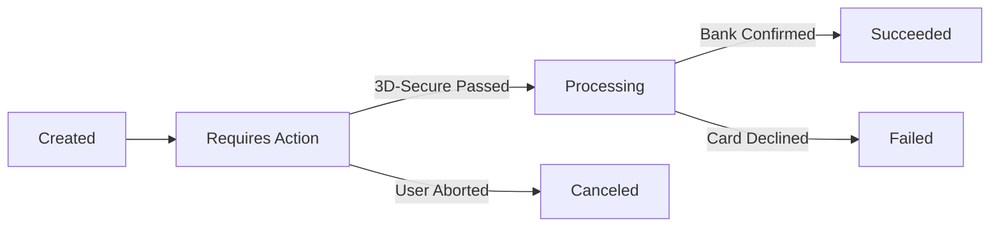

# Payment Processing & Webhooks API Reference

The **Payment Gateway API** orchestrates multi-currency payment intents, idempotent transaction capture, and asynchronous webhook delivery.

---

## 1. Payment Intent Lifecycle

Payment intents transition through deterministic states to prevent duplicate charges:



Fee calculation model for cross-border transactions:

$$
\text{TotalFee}(A) = (A \cdot r_{\text{base}}) + c_{\text{fixed}} + \mathbb{I}_{\text{intl}}(A \cdot r_{\text{fx}})
$$

Where $r_{\text{base}} = 0.029$, $c_{\text{fixed}} = \$0.30$, and cross-border indicator $\mathbb{I}_{\text{intl}} \in \{0, 1\}$.

---

## 2. Creating a Payment Intent

### Endpoint: `POST /v1/payment_intents`

Initiates a payment session with an idempotency key to prevent double billing.

```typescript
import axios from 'axios';

interface CreateIntentParams {
    amountInCents: number;
    currency: 'usd' | 'eur' | 'gbp';
    customerId: string;
    idempotencyKey: string;
}

export async function createPaymentIntent(params: CreateIntentParams): Promise<string> {
    const response = await axios.post(
        'https://api.contextglance.io/v1/payment_intents',
        {
            amount: params.amountInCents,
            currency: params.currency,
            customer: params.customerId,
            confirmation_method: 'automatic'
        },
        {
            headers: {
                'Idempotency-Key': params.idempotencyKey,
                'Authorization': `Bearer ${process.env.PAYMENT_SECRET_KEY}`
            }
        }
    );
    return response.data.client_secret;
}
```

---

## 3. Webhook Event Catalog

All payment events dispatch signed HMAC-SHA256 payloads to registered consumer webhooks:

| Event Type | Trigger Description | Retry Policy | Payload Schema |
| :--- | :--- | :--- | :--- |
| `payment_intent.succeeded` | Funds successfully captured by merchant | 5x Exponential backoff | `IntentObject` |
| `payment_intent.payment_failed` | Insufficient funds or card expired | 3x Linear backoff | `FailureReason` |
| `charge.refunded` | Partial or full refund completed | Immediate retry | `RefundObject` |
| `dispute.created` | Customer filed a chargeback inquiry | 7x Persistent retry | `DisputeRecord` |

---

## 4. Webhook Signature Verification

```python
import hmac
import hashlib
import time

def verify_webhook_signature(payload_bytes: bytes, signature_header: str, secret: str) -> bool:
    """Validates the HMAC-SHA256 header against the incoming raw request body."""
    parts = dict(item.split("=") for item in signature_header.split(","))
    timestamp = int(parts.get("t", 0))
    signature = parts.get("v1", "")

    # Reject events older than 5 minutes
    if abs(time.time() - timestamp) > 300:
        return False

    signed_payload = f"{timestamp}.".encode("utf-8") + payload_bytes
    expected_signature = hmac.new(
        secret.encode("utf-8"),
        signed_payload,
        hashlib.sha256
    ).hexdigest()

    return hmac.compare_digest(expected_signature, signature)
```

<details>
<summary><b>Idempotency Guarantees & Replay Safety</b></summary>
<br>
Every webhook notification contains an `event_id`. Consumer applications MUST maintain an append-only ledger of processed `event_id` tokens for at least 72 hours to prevent reprocessing duplicate webhook signals.
</details>
