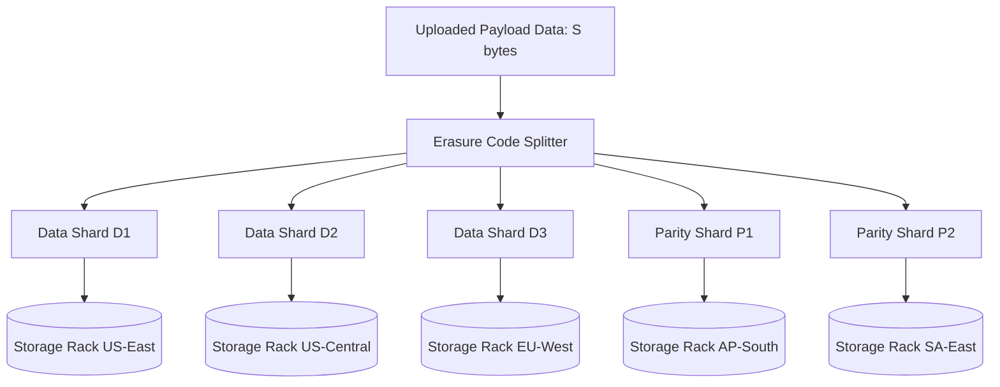

# Cloud Object Storage & CDN API Reference

The **Object Storage API** implements high-availability blob storage, presigned direct uploads, and geographic CDN edge distribution.

---

## 1. Storage Topology & Erasure Coding

Data shards are striped across independent failure domains using Reed-Solomon $RS(k, m)$ encoding:



Storage efficiency and failure tolerance relation:

$$
\text{StorageOverhead} = \frac{k + m}{k}, \quad \text{MaxTolerableNodeLoss} = m
$$

For $RS(8, 4)$, the system tolerates up to $m = 4$ simultaneous drive or datacenter failures with an overhead factor of $1.5\times$.

---

## 2. Generating Presigned Upload URLs

### Endpoint: `POST /v1/buckets/:bucket/presigned_urls`

Allows frontend clients to upload large binary assets directly to edge storage nodes without routing through the backend application servers.

```typescript
import { S3Client, PutObjectCommand } from '@aws-sdk/client-s3';
import { getSignedUrl } from '@aws-sdk/s3-request-presigner';

const s3 = new S3Client({ region: 'auto' });

export async function createUploadTicket(bucket: string, objectKey: string): Promise<string> {
    const command = new PutObjectCommand({
        Bucket: bucket,
        Key: objectKey,
        ContentType: 'application/octet-stream'
    });

    // Valid for 15 minutes (900 seconds)
    return await getSignedUrl(s3, command, { expiresIn: 900 });
}
```

---

## 3. Storage Tier Classes

| Tier Identifier | Retrieval SLA | Durability Guarantee | Minimum Retention | Pricing per GB |
| :--- | :--- | :--- | :--- | :--- |
| `STANDARD_HOT` | Sub-10ms | $99.999999999\%$ (11 9s) | None | $\$0.021$ |
| `INFREQUENT_COOL` | Under 100ms | $99.999999999\%$ (11 9s) | 30 days | $\$0.012$ |
| `ARCHIVE_GLACIER` | 3 - 5 hours | $99.999999999\%$ (11 9s) | 90 days | $\$0.003$ |
| `DEEP_COLD` | 12 hours | $99.999999999\%$ (11 9s) | 180 days | $\$0.00099$ |

---

## 4. Multi-Part Upload Coordination

```python
import math

CHUNK_SIZE = 16 * 1024 * 1024  # 16MB chunks

def compute_part_manifest(file_byte_size: int) -> list[tuple[int, int]]:
    """Calculates part boundary tuples for concurrent parallel upload dispatch."""
    part_count = math.ceil(file_byte_size / CHUNK_SIZE)
    manifest = []
    for part_num in range(1, part_count + 1):
        offset_start = (part_num - 1) * CHUNK_SIZE
        offset_end = min(part_num * CHUNK_SIZE, file_byte_size)
        manifest.append((part_num, offset_end - offset_start))
    return manifest
```

<details>
<summary><b>Cross-Origin Resource Sharing (CORS) Configuration</b></summary>
<br>
Direct web browser uploads require setting CORS headers on the bucket. Specify allowed origins and headers such as `Content-Type`, `Content-MD5`, and `x-amz-server-side-encryption`.
</details>
