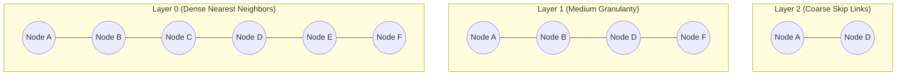

# Vector Engine Library Reference Manual

`@context-glance/vector-engine` is an in-process, SIMD-accelerated similarity search library implementing Hierarchical Navigable Small World (HNSW) indexing and Product Quantization (PQ).

---

## 1. Distance Metric Formats

The vector engine computes nearest neighbors across $D$-dimensional real coordinate spaces $\mathbb{R}^D$:

### Cosine Similarity

$$
\text{CosSim}(\mathbf{u}, \mathbf{v}) = \frac{\mathbf{u} \cdot \mathbf{v}}{\|\mathbf{u}\|_2 \|\mathbf{v}\|_2} = \frac{\sum_{i=1}^D u_i v_i}{\sqrt{\sum_{i=1}^D u_i^2} \sqrt{\sum_{i=1}^D v_i^2}}
$$

### Squared Euclidean Distance ($L_2$)

$$
D_{L2}^2(\mathbf{u}, \mathbf{v}) = \|\mathbf{u} - \mathbf{v}\|_2^2 = \sum_{i=1}^D (u_i - v_i)^2
$$

### Dot Product (Inner Product)

$$
\langle \mathbf{u}, \mathbf{v} \rangle = \sum_{i=1}^D u_i v_i
$$

---

## 2. HNSW Multi-Layer Graph Indexing



The probability that an inserted node reaches level $l$ is controlled by parameter $m_L$:

$$
P(\text{level} \ge l) = \exp(-l \cdot m_L), \quad m_L = \frac{1}{\ln(M)}
$$

---

## 3. Basic Library Usage in TypeScript

```typescript
import { VectorIndex, MetricType } from '@context-glance/vector-engine';

export async function createEmbeddingIndex(dimensions: number = 384): Promise<VectorIndex> {
    const index = new VectorIndex({
        dimensions,
        metric: MetricType.Cosine,
        maxElements: 100_000,
        m: 16,            // Number of bidirectional links per node
        efConstruction: 200 // Exploration factor during index construction
    });

    // Bulk ingest vector embeddings
    const sampleVector = new Float32Array(dimensions).fill(0.05);
    await index.addPoint('doc_chunk_42', sampleVector, { title: 'Auth Architecture' });

    // Execute k-NN similarity query
    const results = await index.searchKNN(sampleVector, 5, { efSearch: 50 });
    console.log(`Top match score: ${results[0].distance}`);
    return index;
}
```

---

## 4. Hyperparameter Comparison Table

| Parameter | Recommended Default | Range | Impact on Build Time | Impact on Recall Accuracy |
| :--- | :--- | :--- | :--- | :--- |
| `M` | `16` | `4` - `64` | Higher $M$ increases memory and insertion latency | Substantial increase in recall |
| `efConstruction` | `200` | `40` - `500` | Linear scaling with build time | Crucial for high-dimensional graphs |
| `efSearch` | `50` | `10` - `300` | Increases query latency | Enables $> 99.5\%$ recall at query time |
| `subquantizers` | `8` | `4` - `32` | Negligible | Trades precision for $4\times-8\times$ RAM reduction |

<details>
<summary><b>Memory Footprint & SIMD AVX-512 Acceleration</b></summary>
<br>
When running on x86_64 architectures supporting AVX-512 or ARM64 Neon, the engine automatically selects vectorized SIMD kernels for FMA (Fused Multiply-Add) inner product calculations, achieving throughput exceeding 1.2M queries/sec on a 16-core workstation.
</details>
